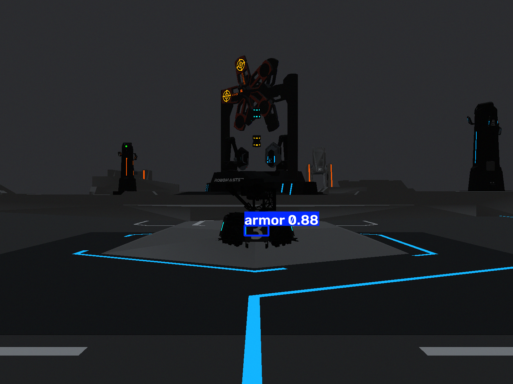

# 装甲板检测 · 二阶段考核交付（第三讲 + 神经网络训练产物）

DeepSeek Harness 无关，本仓库是 RoboMaster 校队二阶段培训考核的提交物：
基于 `Exusiai-R/hnurmvision_edu` 的第三讲装甲板检测实现、20 秒仿真演示视频，
以及装甲板 YOLO 检测网络的训练产物。

## 目录

```
.
├── demo/
│   └── armor_demo_20s.mp4        # 20.0s · 1440x1080 · 30fps · H.264
├── code/
│   ├── lesson02_io.cpp           # 第二讲：/image_raw 订阅 + /vision_send_data 发布
│   ├── lesson03_detection.cpp    # 第三讲：传统视觉装甲板检测（本仓库核心）
│   └── main.cpp                  # 主循环 + 检测框可视化 + 录制参数
├── patch/
│   └── lesson03-armor-detection.patch   # 相对课程仓库的完整 diff
├── artifacts/
│   ├── weights/{best.pt,last.pt}
│   ├── curves/                   # loss / mAP / P / R 曲线、混淆矩阵、逐轮指标
│   └── inference/                # 含置信度的推理可视化（val 60 张 + 仿真原帧）
├── tools/                        # 采帧、自标注、切分、训练、演示驱动脚本
└── docs/                         # 视频截图
```

## 演示视频

`demo/armor_demo_20s.mp4`（20.0 秒，≤20s 要求内）。

录制流程：仿真器 + 训练程序运行后，用 X11 XTEST 向仿真窗口注入按键
（`W/A/S/D` 平移底盘、`Q/E` 旋转底盘、`F5` 关闭订阅自瞄后方向键控云台），
训练程序以 30fps 把带检测框的画面写入 mp4，裁掉启动阶段后保留 20 秒。


## 第三讲实现要点（传统视觉）

`code/lesson03_detection.cpp`

1. **HSV 分割**：蓝色/青色 H∈[85,135]，红色 H∈[0,12]∪[168,180]，配合饱和度/亮度双阈值；
2. **形态学闭运算**：3×9 核把被号码牌切断的灯条接回去；
3. **灯条过滤**：长边≥16px、长宽比≥1.55、短边≤90px、面积≥35px²、竖直倾角<55°；
4. **灯条配对**：同色、高度差<40%、中心差<42%、倾角差<20°、间距/灯条高度∈[0.28,4.5]、
   外接框宽高比∈[1.35,5.0]；
5. **大小板**：宽高比 > 2.85 为大装甲板（哨兵）；
6. **置信度**：高度一致 0.45 + 倾角一致 0.30 + 间距合理 0.25，阈值 0.55；
7. **去重**：框 IoU > 0.45 的 NMS。

主程序 `code/main.cpp` 负责画框（绿=小板、橙=大板，标注置信度）和可选录制，
检测逻辑与显示分离，`Armor::corners` 顺序为左上、右上、右下、左下。

## 接入课程仓库

```bash
git clone https://github.com/Exusiai-R/hnurmvision_edu.git
cd hnurmvision_edu
git apply /path/to/patch/lesson03-armor-detection.patch
# 或直接把 code/ 下三个文件覆盖到对应位置
./scripts/build_training.sh
./scripts/run_simulator.sh     # 终端 1
./scripts/run_training.sh      # 终端 2
```

> 注意：仓库路径含中文时 `colcon` 会在 rosidl 生成阶段崩溃，请放在纯 ASCII 路径下构建。

## 神经网络训练产物

- 模型：YOLOv8n（3.13M 参数）
- 数据：仿真器 `/image_raw` 原始帧 300 张（静止/平移/旋转靶 + 底盘移动），
  由第三讲检测器**自标注**（self-training）生成单类标注，人工抽查 30 张，
  按 8:2 划分为 240 / 60；
- 训练：640×640、batch 8、60 epochs（patience 25 早停，最佳第 23 轮），
  RTX 4060 Laptop 约 2 分钟；
- 验证集 60 张 / 60 目标：**P 0.999，R 1.000，mAP50 0.995，mAP50-95 0.995**。




复现：

```bash
python3 tools/capture_frames.py dataset/raw 300 15
g++ -std=c++17 -O2 tools/label_frames.cpp code/lesson03_detection.cpp \
    -I<repo>/include -I/usr/include/eigen3 $(pkg-config --cflags --libs opencv4) -o tools/label_frames
./tools/label_frames dataset/raw dataset/labels_all dataset/viz
python3 tools/make_dataset.py --images dataset/raw --labels dataset/labels_all --out dataset
python3 tools/train_yolo.py --model yolov8n.pt --epochs 60 --batch 8 --imgsz 640
```

## 已知限制

- 传统检测依赖灯条颜色/亮度阈值，强反光、完全遮挡、距离过远（灯条 < 20px）会漏检；
- `class_id` 恒为 -1，未做数字识别；需要编号时可将 `best.pt` 导出 ONNX，在
  `lesson03_detection()` 里接 `cv::dnn` 分支；
- 训练集与验证集同分布，指标偏乐观，不代表实车泛化能力；
- 视频用程序内 `VideoWriter` 录制，画面只含相机窗口，不含仿真器界面。
