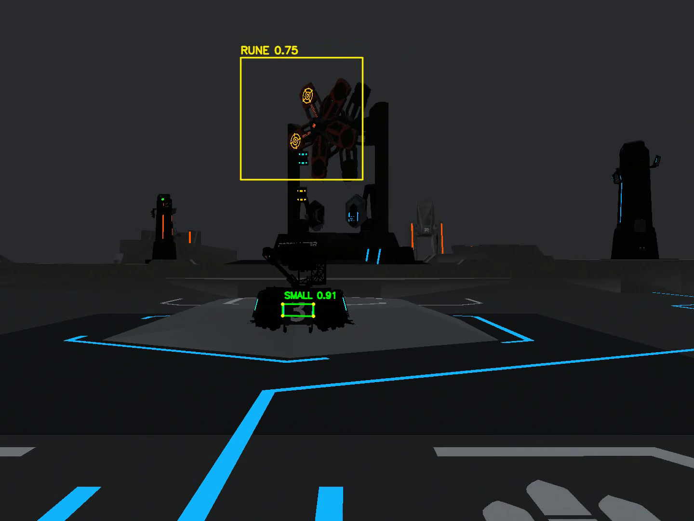

# 装甲板检测 · 二阶段考核交付（第三讲 + 神经网络训练产物）

RoboMaster 校队二阶段培训考核的提交物：基于 `Exusiai-R/hnurmvision_edu` 的第三讲
装甲板检测实现、20 秒仿真演示视频，以及在**老师提供的数据集**上训练的 14 类装甲板
检测网络产物。

## 目录

```
.
├── demo/
│   └── armor_demo_20s.mp4          # 20.0s · 1440×1080 · 30fps · H.264 Baseline（兼容性最好）
├── code/
│   ├── lesson02_io.cpp             # 第二讲：/image_raw 订阅 + /vision_send_data 发布
│   ├── lesson03_detection.cpp      # 第三讲：传统视觉装甲板检测
│   └── main.cpp                    # 主循环 + 检测框可视化 + 录制参数
├── patch/
│   └── lesson03-armor-detection.patch   # 相对课程仓库的完整 diff
├── artifacts/
│   ├── weights/{best.pt,last.pt}   # YOLOv8n，14 类
│   ├── curves/                     # results、BoxPR/P/R/F1、混淆矩阵、labels
│   ├── inference/                  # 验证集 48 张 + val_batch 推理图（均带类别与置信度）
│   └── metrics.json                # 验证指标（整体 + 每类 mAP50）
├── tools/                          # 训练、导出、演示驱动脚本
└── docs/                           # 视频截图
```

## 演示视频

`demo/armor_demo_20s.mp4`（20.0 秒，≤20s 要求内）。

录制流程：仿真器 + 训练程序运行后，用 X11 XTEST 向仿真窗口注入按键
（`W/A/S/D` 平移底盘、`Q/E` 旋转底盘、`F5` 关闭订阅自瞄后方向键控云台），
训练程序以 30fps 把带检测框的画面写入 mp4，裁掉启动阶段后保留 20 秒。



## 第三讲实现要点（传统视觉）

`code/lesson03_detection.cpp`

1. **HSV 分割**：蓝/青 H∈[85,135]，红 H∈[0,12]∪[168,180]，配合饱和度/亮度双阈值；
2. **形态学闭运算**：3×9 核把被号码牌切断的灯条接回去；
3. **灯条过滤**：长边≥16px、长宽比≥1.55、短边≤90px、面积≥35px²、竖直倾角<55°；
4. **灯条配对**：同色、高度差<40%、中心差<42%、倾角差<20°、间距/灯条高度∈[0.28,4.5]、
   外接框宽高比∈[1.35,5.0]；
5. **大小板**：宽高比 > 2.85 为大装甲板（哨兵）；
6. **置信度**：高度一致 0.45 + 倾角一致 0.30 + 间距合理 0.25，阈值 0.55；
7. **去重**：框 IoU > 0.45 的 NMS。

`code/main.cpp` 负责画框（绿=小板、橙=大板，标注置信度）与可选录制；
检测逻辑与显示分离，`Armor::corners` 顺序为左上、右上、右下、左下。

## 接入课程仓库

```bash
git clone https://github.com/Exusiai-R/hnurmvision_edu.git
cd hnurmvision_edu
git apply /path/to/patch/lesson03-armor-detection.patch
./scripts/build_training.sh
./scripts/run_simulator.sh     # 终端 1
./scripts/run_training.sh      # 终端 2
```

> 仓库路径含中文时 `colcon` 会在 rosidl 生成阶段崩溃，请放在纯 ASCII 路径下构建。

## 神经网络训练产物（老师提供的数据集）

### 数据

来自老师下发的 `dataset.zip`（14 类 RoboMaster 装甲板）：

- 原始 17996 张，筛出带 13 列标注的 7046 张，按 8:2 划分为 **train 5637 / val 1409**；
- 类别：`B1 B2 B3 B4 B5 BO BS R1 R2 R3 R4 R5 RO RS`；
- 标注每行 13 列：`class cx cy w h x1 y1 x2 y2 x3 y3 x4 y4`（外接框 + 四角点，均归一化），
  检测训练取前 5 列作为框，角点暂未使用。

### 训练

- 模型：YOLOv8n（3.14M 参数，8.7 GFLOPs）
- 640×640，batch 16，35 epochs，RTX 4060 Laptop 约 25 分钟
- 命令：

```bash
python tools/train_teacher.py        # data.yaml 指向解压后的数据集
```

`data.yaml` 示例：

```yaml
path: /path/to/armor_teacher
train: train/images
val: val/images
names: {0: B1, 1: B2, 2: B3, 3: B4, 4: B5, 5: BO, 6: BS,
        7: R1, 8: R2, 9: R3, 10: R4, 11: R5, 12: RO, 13: RS}
```

### 验证结果（val 1409 张 / 2362 个实例）

| 指标 | 数值 |
|---|---|
| Precision | 0.932 |
| Recall | 0.826 |
| mAP@50 | 0.902 |
| mAP@50-95 | 0.775 |

| 类别 | mAP50 | 类别 | mAP50 |
|---|---|---|---|
| B1 | 0.899 | R1 | 0.850 |
| B2 | 0.832 | R2 | 0.851 |
| B3 | 0.826 | R3 | 0.879 |
| B4 | 0.895 | R4 | 0.884 |
| B5 | 0.886 | R5 | 0.897 |
| BO | 0.988 | RO | 0.958 |
| BS | 0.993 | RS | 0.989 |


推理可视化见 `artifacts/inference/val/`（48 张，每张带类别与置信度），
完整指标见 `artifacts/metrics.json`。

## 已知限制

- 传统检测依赖灯条颜色/亮度阈值，强反光、完全遮挡、灯条 < 20px 时会漏检；
- 检测网络与第三讲代码目前是并行交付：`lesson03_detection()` 走传统视觉，
  网络产物独立提供。若要让检测框直接带编号，可把 `best.pt` 导出 ONNX，
  在 `lesson03_detection()` 里接 `cv::dnn` 分支；
- 网络只在老师数据集上训练/验证，部署到实车前建议补采现场光照数据做微调；
- 视频用程序内 `VideoWriter` 录制，画面只含相机窗口，不含仿真器界面。
