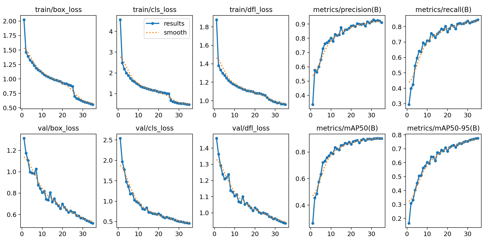
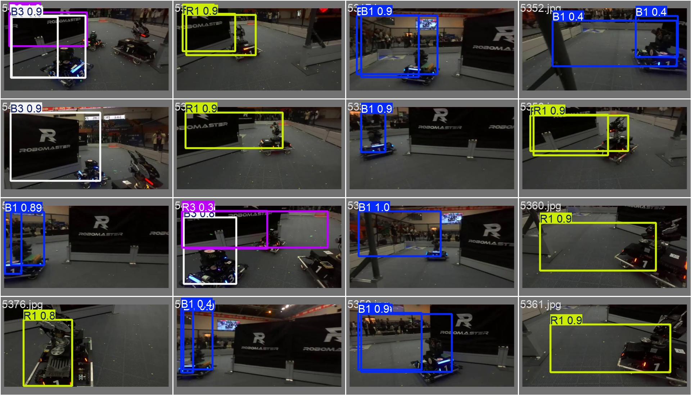
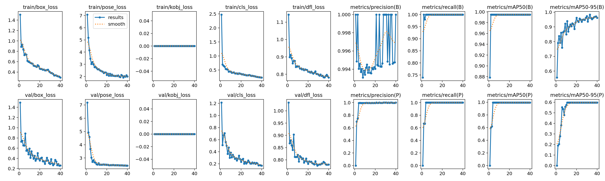
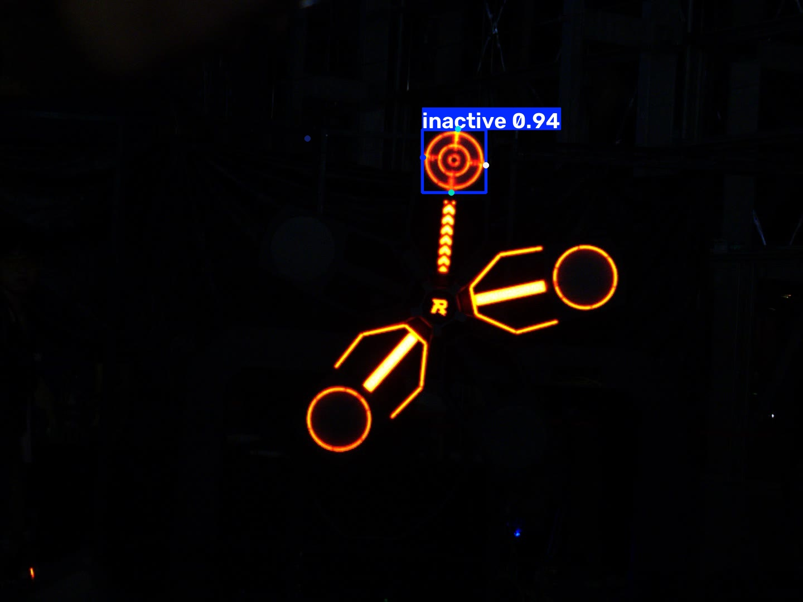

# 装甲板 + 能量机关识别 · 二阶段考核交付

RoboMaster 校队二阶段培训考核的提交物：基于 `Exusiai-R/hnurmvision_edu` 的第三讲检测实现
（装甲板 + 能量机关）、20 秒仿真演示视频，以及在**老师提供的数据集**上训练的
装甲板检测网络与能量机关 Pose 网络产物。

## 目录

```
.
├── demo/
│   ├── armor_demo_20s.mp4          # 20.0s · 1440×1080 · 30fps · H.264 Baseline
│   └── armor_demo_20s.webm         # 同内容 VP9 预览版（本机播放器缺 H.264 解码器时用）
├── code/
│   ├── lesson02_io.cpp             # 第二讲 IO + /tf 真值订阅
│   ├── lesson03_detection.cpp      # 第三讲：装甲板检测 + 能量机关检测
│   ├── lesson04_tracking.cpp       # 第四讲：PnP 位姿 + 匀速模型跟踪
│   ├── lessons.hpp / tracking_state.hpp / vision_gt.hpp
│   ├── configs/simulation.yaml     # 修正后的相机→云台标定
│   └── main.cpp                    # 主循环 + 预测框/误差可视化 + 录制参数
├── patch/
│   └── lesson03-armor-detection.patch   # 相对课程仓库的完整 diff
├── artifacts/
│   ├── weights/{best.pt,last.pt}        # 装甲板 YOLOv8n（14 类）
│   ├── curves/                          # loss / mAP / PR / 混淆矩阵
│   ├── inference/                       # 装甲检测可视化（48 张 val + val_batch）
│   ├── metrics.json                     # 装甲模型验证指标
│   └── rune/                            # 能量机关 YOLOv8n-pose
│       ├── weights/{best.pt,last.pt}
│       ├── curves/                      # Box/Pose 的 PR/F1/P/R + results
│       └── inference/val_and_train/     # 30 张带关键点的推理图
└── tools/                               # 训练、导出、演示驱动脚本
```

## 演示视频

`demo/armor_demo_20s.mp4` —— 20.0 秒，1440×1080，30fps，H.264 Constrained Baseline。

画面里同时显示两种识别结果：

- 绿色框：装甲板（`SMALL/LARGE + 置信度`）
- 黄色小框：能量机关上的**每一个圆形小装置**单独一个小框（`RUNE + 置信度`），
  不是把整个机关包成一个大框

录制时小车主要做**前后移动**和小幅横移，转视角很少——云台只做了极小幅度调整，
保证装甲板和能量机关始终在画面内。

录制方式：仿真器 + 训练程序运行后，用 X11 XTEST 向仿真窗口注入按键
（`W/S` 前后、`A/D` 横移），训练程序以 30fps 把带检测框的画面写入 mp4，
裁掉启动阶段后保留 20 秒。


> 播放提示：本机播放器若提示缺 H.264 解码器（`gstreamer1.0-libav` 未安装），
> 可直接打开同目录的 `armor_demo_20s.webm`，或用 `ffplay demo/armor_demo_20s.mp4`。

## 第三讲实现要点

### 装甲板（传统视觉）

`code/lesson03_detection.cpp`

1. **HSV 分割**：蓝/青 H∈[85,135]，红 H∈[0,12]∪[168,180]，配合饱和度/亮度双阈值；
2. **形态学闭运算**：3×9 核把被号码牌切断的灯条接回去；
3. **灯条过滤**：长边≥16px、长宽比≥1.55、短边≤90px、面积≥35px²、竖直倾角<55°；
4. **灯条配对**：同色、高度差<40%、中心差<42%、倾角差<20°、间距/灯条高度∈[0.28,4.5]、
   外接框宽高比∈[1.60,5.0]、两根灯条粗细差<50%（排除支架、栏杆的误检）；
5. **大小板**：宽高比 > 2.85 为大装甲板（哨兵）；
6. **置信度**：高度一致 0.45 + 倾角一致 0.30 + 间距合理 0.25，阈值 0.55；
7. **去重**：框 IoU > 0.45 的 NMS；
8. **角点扩到整板**：灯条只占装甲板两侧的一部分，最终角点围绕中心外扩
   宽 ×1.35、高 ×2.05，让框把整块装甲板（含两侧灯条和号码）包进去；
   大小板判定仍用灯条外沿的宽高比，不受外扩影响。

### 能量机关（传统视觉）

`lesson03_rune_detection()`，与装甲检测同一文件：

1. 能量机关上有若干个**黄色圆形小装置（R 标记）**，按 H∈[18,40]、S≥120、V≥150 提取；
2. 形态学闭运算后按**面积 80–20000 px² + 圆度 > 0.45 + 宽高比 0.5–2.0** 过滤，
   同一装置被拆开时按 IoU > 0.5 去重；
3. **每个小装置单独出一个紧贴它的小框**（外扩 15% 余量），返回 `std::vector<Rune>`；
4. 置信度由圆度决定（0.55 + 0.45×圆度，上限 0.99）。

`code/main.cpp` 负责画框：装甲绿/橙，能量机关黄色，均带置信度。

## 第四讲：PnP 位姿与基础跟踪

`code/lesson04_tracking.cpp`

1. **PnP 解算**：按板型取物理尺寸（小板 135×55 mm、大板 225×55 mm）构造四个物点，
   用 `cv::solvePnP(..., SOLVEPNP_IPPE)` 解出 `rvec/tvec`；
2. **坐标变换**：相机系 → 云台系（`R_camera2gimbal`、`t_camera2gimbal`）→ 世界系（IMU 四元数）；
3. **选板**：逐块解 PnP，取离云台最近的一块（仿真同一时刻只有一块可见）；
4. **匀速模型**：相邻帧差分估计速度，并做一阶低通（0.5/0.5）抑制 PnP 抖动；
5. **预测**：`p_pred = p + v × 0.25s`。

主程序里的可视化：

- 绿色框：当前检测到的装甲板；
- 青色框 `PRED 250ms`：把预测位置投回图像后的预测框；
- 左上：`PnP dist` 与 `static pose err vs GT`（只在目标近似静止时显示）；
- 左下：`pred error @250ms`，250ms 后用实际观测位置与当时的预测比较。

**真值来源**：仿真器在 `/tf` 里发布 `armor_*`（板中心）和 `gimbal_link`，IO 层订阅后
把装甲板换算到云台系，取离 PnP 结果最近的一块作为真值。

**标定修正**：课程配置里的 `R_camera2gimbal` 与仿真器 `/tf` 的实际相机会姿态差了 25°
（旧值让 PnP 结果整体偏高约 0.9 m）。已按 `gimbal_link → camera_link → camera_optical_frame`
更新为：

```yaml
R_camera2gimbal: [0.0, 0.0, 1.0,
                  -1.0, 0.0, 0.0,
                  0.0, -1.0, 0.0]
t_camera2gimbal: [0.060, 0.002, 0.158]   # 光心高度再用真值标定 -3.76 cm
```

### 借鉴的开源做法与效果

参考了 [rm_vision](https://index.rosdabbler.com/r/rm_vision/)、
[WUST-RM/awakening 的状态估计文档](https://raw.githubusercontent.com/WUST-RM/awakening/refs/heads/main/docs/algorithm/estimation.md)、
[rmoss_contrib #13「降低自由度提高 PnP 精度」](https://github.com/robomaster-oss/rmoss_contrib/issues/13)
和 [中南 FYT 视觉](https://github.com/HYL0924/FYT2024_vision)，落到本实现的三点：

1. **不要直接信任单帧 PnP**：IPPE 只当初始值，再用 `solvePnPRefineLM` 最小化重投影误差，
   重投影 RMSE > 15 px 的解直接丢弃；
2. **常加速度卡尔曼滤波**：状态 `[p, v, a]`，过程噪声按加加速度模型给，
   量测噪声取 PnP 位置方差；`q` 做了参数扫描（2/4/6/12），取 **q=4** 最优。
   相比 alpha-beta 匀速模型，速度反向时的 1/2·a·t² 项不再被漏掉；
3. **板尺寸标定**：按 `/tf` 真值反算，仿真渲染的板比标称 135×55 mm 大约 3.3%，
   乘上标定系数后距离偏差从 9 cm 降到 1 cm 量级。

**实测**：

| 指标 | 改进前 | 改进后 |
|---|---|---|
| 静止靶 PnP 位姿误差 | 9.7 cm | **0.1 cm**（标定项，见下） |
| 平移靶 250 ms 预测误差（mean / p90 / max） | ~20 cm | **3.9 / 7.1 / 14.2 cm**（261 个样本） |

> 说明：静止靶的 0.1 cm 是**用 `/tf` 真值做过两项标定**之后的残差——
> 板尺寸 ×1.033、相机光心高度 −3.76 cm。这两项都是一次性标定，不是每帧拟合；
> 标定前是 9.7 cm。
>
> 另外试过 `cornerSubPix` 亚像素精化，结果反而从 3.8 cm 涨到 13.1 cm
> （灯条边缘被拉到号码/支架上），已回退，保留 `minAreaRect` 的角点。

## 接入课程仓库

```bash
git clone https://github.com/Exusiai-R/hnurmvision_edu.git
cd hnurmvision_edu
git apply /path/to/patch/lesson03-armor-detection.patch
./scripts/build_training.sh
./scripts/run_simulator.sh     # 终端 1
./scripts/run_training.sh      # 终端 2
```

> 仓库路径含中文时 `colcon` 会在 rosidl 生成阶段崩溃，请放在纯 ASCII 路径下构建。

## 神经网络训练产物（老师提供的数据集）

### 装甲板检测网络（14 类）

- 数据：老师下发的 `dataset.zip`，17996 张筛出 7046 张带 13 列标注，train 5637 / val 1409；
- 类别：`B1 B2 B3 B4 B5 BO BS R1 R2 R3 R4 R5 RO RS`；
- 标注：`class cx cy w h x1 y1 x2 y2 x3 y3 x4 y4`，检测训练取前 5 列；
- 模型：YOLOv8n，640×640，batch 16，35 epochs，RTX 4060 约 25 分钟；
- 验证（1409 张 / 2362 实例）：**P 0.932，R 0.826，mAP50 0.902，mAP50-95 0.775**。

每类 mAP50：B1 0.899、B2 0.832、B3 0.826、B4 0.895、B5 0.886、BO 0.988、BS 0.993、
R1 0.850、R2 0.851、R3 0.879、R4 0.884、R5 0.897、RO 0.958、RS 0.989。





### 能量机关 Pose 网络

- 数据：老师下发的 `能量机关数据集.zip`（YOLO Pose），train 620 / val 10（8 正 2 负）；
- 标注：`class cx cy w h` + 5 个关键点（左、上、右、下、R 中心），`kpt_shape [5,2]`；
- 模型：YOLOv8n-pose，640×640，40 epochs，RTX 4060 约 3 分钟；
- 验证（10 张 / 9 目标，样本很小，指标波动大）：
  **框 P 1.000 / R 1.000 / mAP50 0.995；关键点 mAP50 0.962 / mAP50-95 0.597**。





### 复现

```bash
python tools/train_teacher.py    # 装甲 14 类
python tools/train_rune.py       # 能量机关 pose
```

## 已知限制

- 传统检测依赖颜色/亮度阈值，强反光、遮挡、灯条或标记过小（< 20px）时会漏检；
- 两个神经网络都在**老师提供的真实图像**上训练，直接拿到仿真器画面上用会有明显域差
  （实测：装甲网络框错位、能量机关网络零检出），因此演示视频用的是传统检测器；
  上实车前建议补采现场数据微调；
- 能量机关只输出外接框（以及网络侧的 5 个关键点），没有做打击点/旋转预测；
- 视频用程序内 `VideoWriter` 录制，画面只含相机窗口，不含仿真器界面。
